# OMEGA-Fusion — RISC-V SoC + INT4/INT8 Matrix Accelerator, RTL to GDSII on SKY130

<p align="center">
  
</p>
<p align="center"><em>Final routed GDSII of <code>omega_fusion_soc_asic</code> — SkyWater SKY130A, 1800 × 1800 µm, 10,323 flip-flops, 3.3 m of wire, 481 k vias. Rendered from the real GDS with KLayout.</em></p>

**OMEGA-Fusion is a complete open-source chip-design project: from SystemVerilog to a signed-off GDSII layout.** A single-cycle RISC-V core feeds a 4×4 INT4/INT8 matrix-multiply accelerator over a memory-mapped bus; the whole SoC was synthesized, placed, clock-tree-balanced, routed, ECO-tuned, verified in 9 PVT corners with extracted parasitics, and then integrated into the Efabless **Caravel** `user_project_wrapper`.

| | |
|---|---|
| **Process / library** | SkyWater SKY130A, `sky130_fd_sc_hd` |
| **Die** | 1800 × 1800 µm (3.24 mm²), 179 pins |
| **Design size** | 112,514 instances · 10,323 flip-flops · 2,168 + 102 clock buffers/inverters |
| **Clock** | 10 MHz target — worst setup slack **+54.7 ns** |
| **Layout sign-off** | DRC 0 · LVS match (68,162 devices) · XOR 0 · antenna 0 · slew/cap 0 |
| **Timing** | Setup and hold met in **9/9 PVT-RC corners**; worst hold **+102 ps** |
| **Flow** | LibreLane 3.0.11 → Yosys · OpenROAD · TritonCTS · TritonRoute · Magic · KLayout · Netgen |

---

## 1. Sign-off results

| Check | Result |
|---|---|
| DRC — Magic, KLayout, TritonRoute | **0 violations** |
| LVS (Netgen) | **Circuits match** — 68,162 devices, 67,003 nets |
| GDS integrity — Magic vs KLayout XOR | **0 differences** |
| Antenna after detailed routing | **0 nets, 0 pins** |
| Setup / hold — 9 PVT-RC corners, extracted SPEF | **Met in every corner** — worst setup +54.7 ns, worst hold +102 ps |
| Max slew / max capacitance — 9 corners | **0 / 0 violations** |
| Gate-level simulation of the post-route netlist | **Pass** |

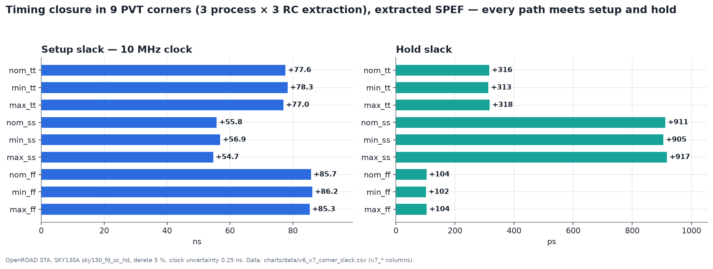

The design closes timing with wide margin at 10 MHz in all nine process / voltage / temperature / RC-extraction corners. Hold margin was engineered with an ECO loop that inserts delay buffers and clock-path buffers using the real extracted parasitics — RTL, SDC and limits untouched ([`docs/results/V7_ECO_REPORT.md`](docs/results/V7_ECO_REPORT.md)).

| | |
|---|---|
| 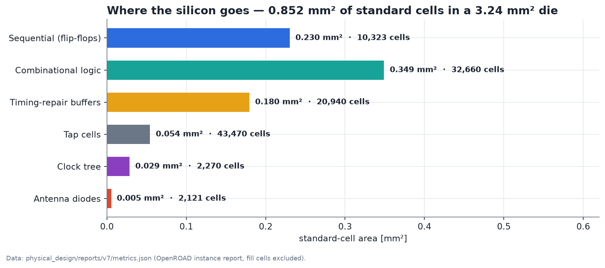 | 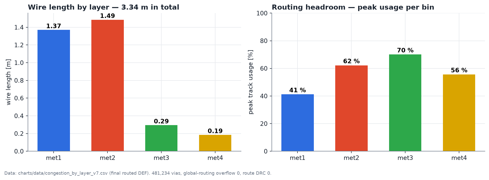 |
| **Where the silicon goes** — 10,323 flip-flops, 32,660 logic cells, a 2,270-cell clock tree. | **Routing by layer** — 3.34 m of wire, peak track usage 70 %: ample headroom. |

---

## 2. The physical design journey (real captures)

Every image below is generated from real physical files (ODB / DEF / GDS) — nothing is synthetic. Sources and tools per image: [`docs/results/VISUAL_GALLERY.md`](docs/results/VISUAL_GALLERY.md).

<table>
<tr><th>Floorplan</th><th>Power grid</th></tr>
<tr><td>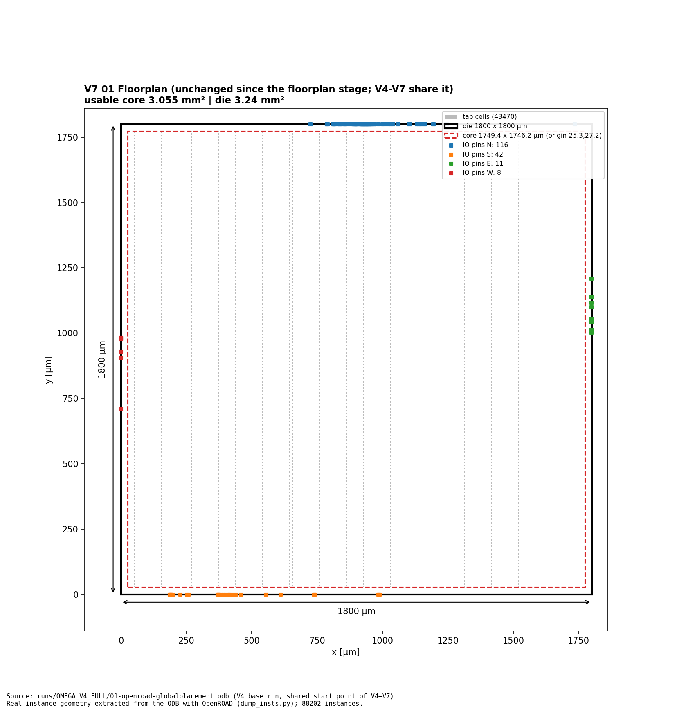<br>Die, core and pin sides.</td>
    <td><br>met1 rails + met4 straps, alternating VDD/VSS.</td></tr>
<tr><th>Global placement</th><th>Detailed placement</th></tr>
<tr><td>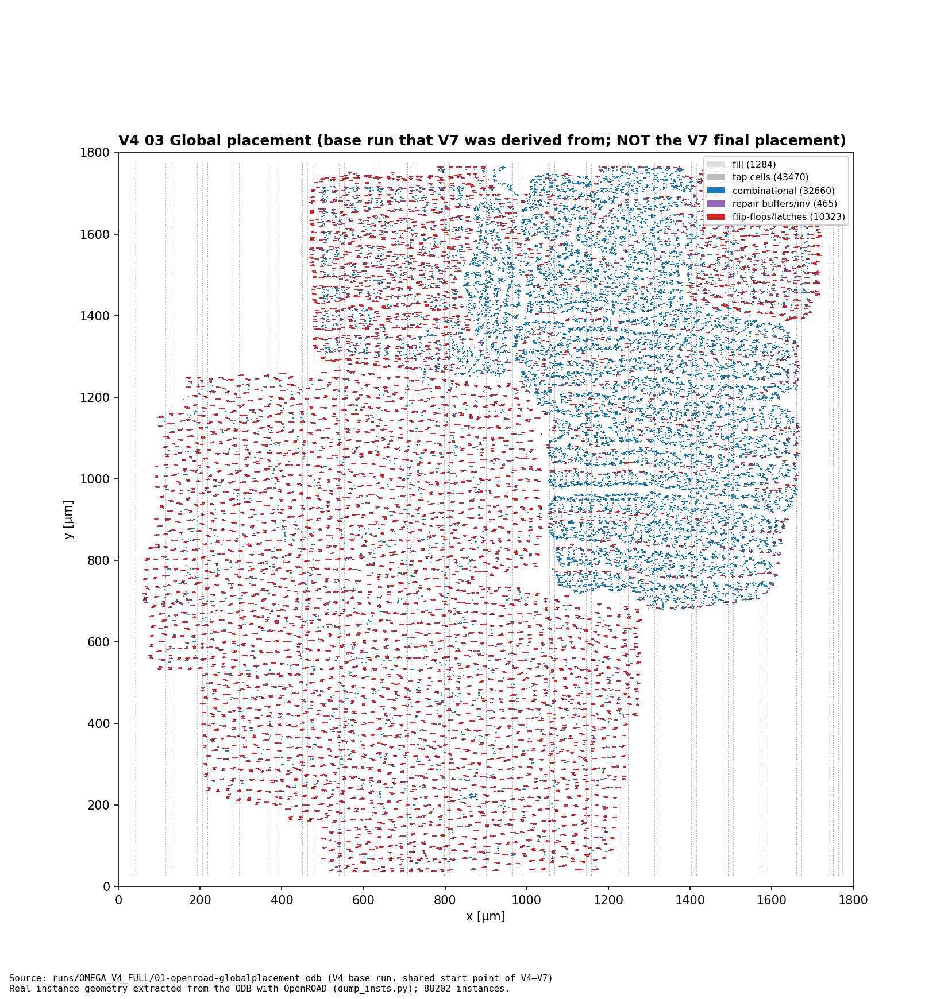<br>Starting point: flip-flop arrays and datapath logic clusters.</td>
    <td><br>Legalized placement of 112 k cells.</td></tr>
<tr><th>Placement density</th><th>Clock tree</th></tr>
<tr><td><br>Cell area per 30 µm bin.</td>
    <td>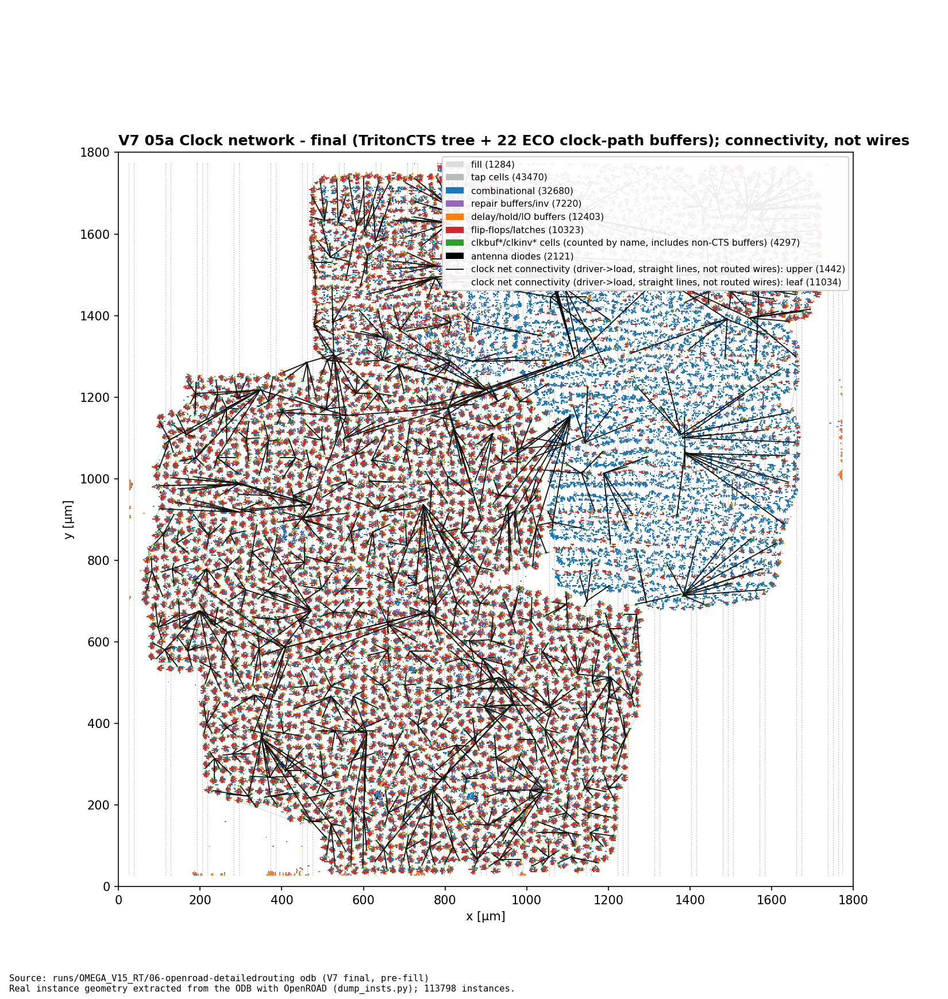<br>TritonCTS: 10,323 sinks, driver→load connectivity.</td></tr>
<tr><th>Global routing</th><th>Routing congestion</th></tr>
<tr><td><br>Routing guides by layer, overflow 0.</td>
    <td><br>Peak track usage 0.41 / 0.62 / 0.70 / 0.56 (met1–met4).</td></tr>
<tr><th>Detailed routing</th><th>Final GDSII</th></tr>
<tr><td>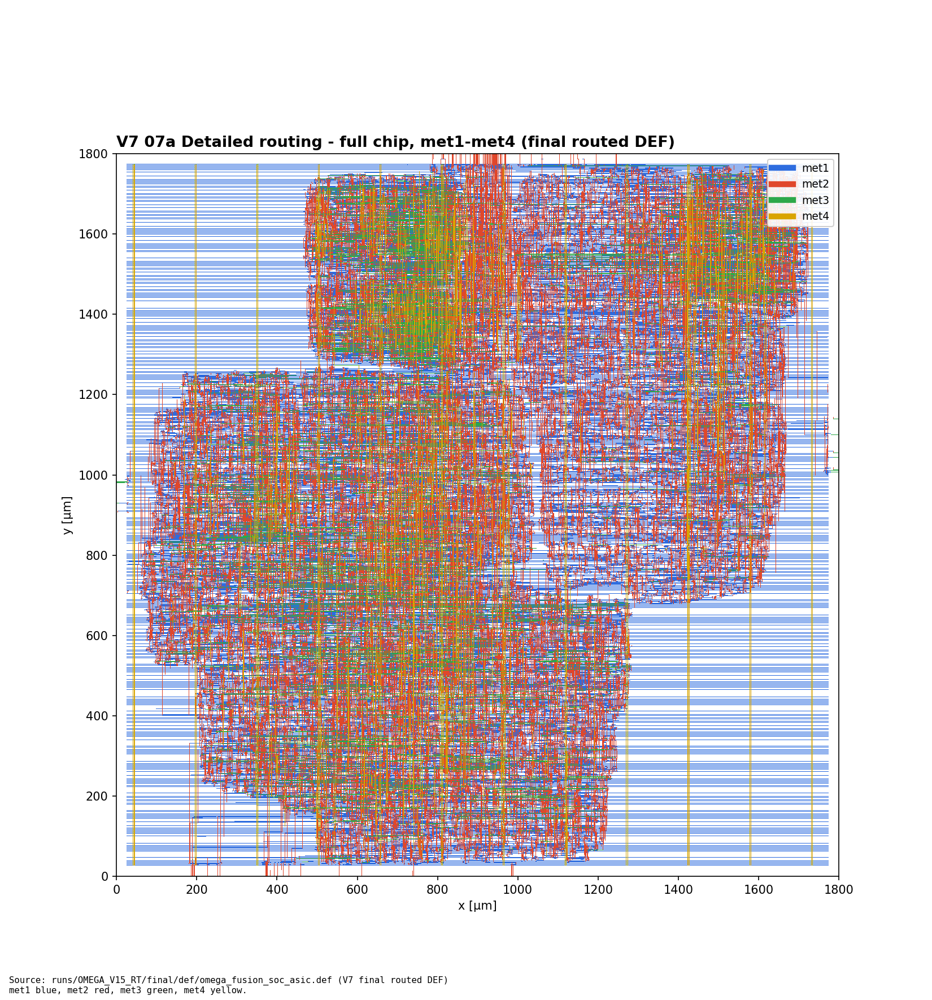<br>met1 blue · met2 red · met3 green · met4 yellow.</td>
    <td>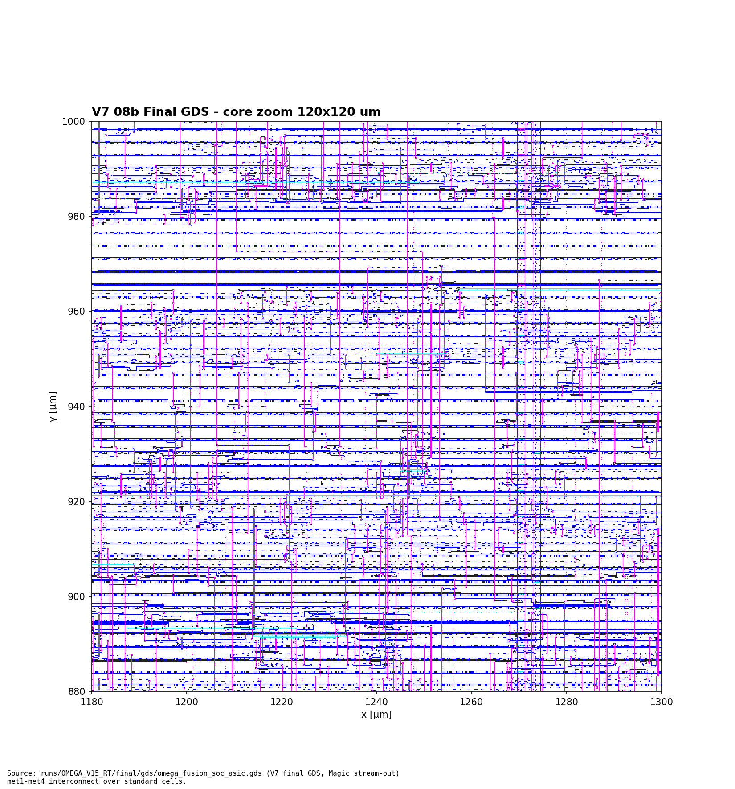<br>120 × 120 µm of the final GDS.</td></tr>
</table>

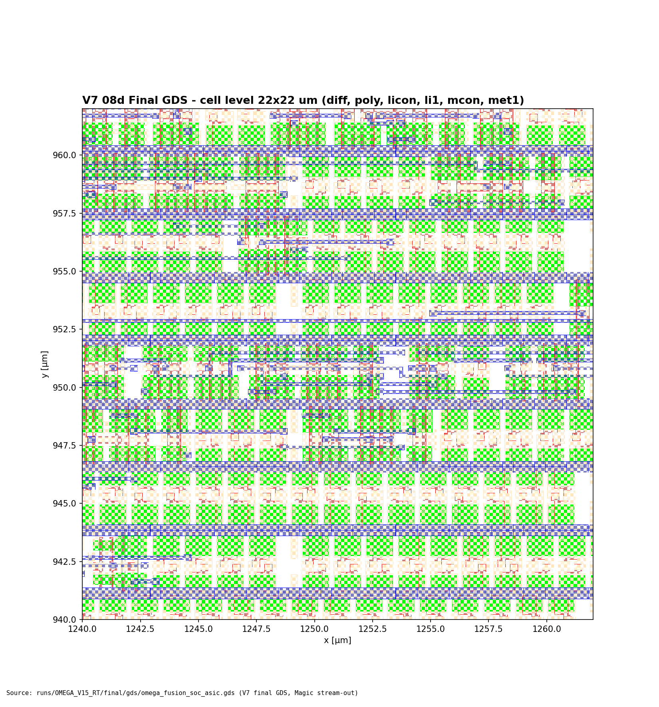
*22 × 22 µm of the GDSII: diffusion, poly, li1, mcon and met1 — individual standard cells.*

---

## 3. Caravel integration

The macro was dropped into the Efabless Caravel `user_project_wrapper` (2920 × 3520 µm) as `mprj`, and the full wrapper flow was run: floorplan → PDN → placement → CTS → routing → antenna repair → RCX → 9-corner STA → Magic DRC / XOR.

| Floorplan: macro faces the I/O | Power grid (8 power nets) |
|---|---|
|  | 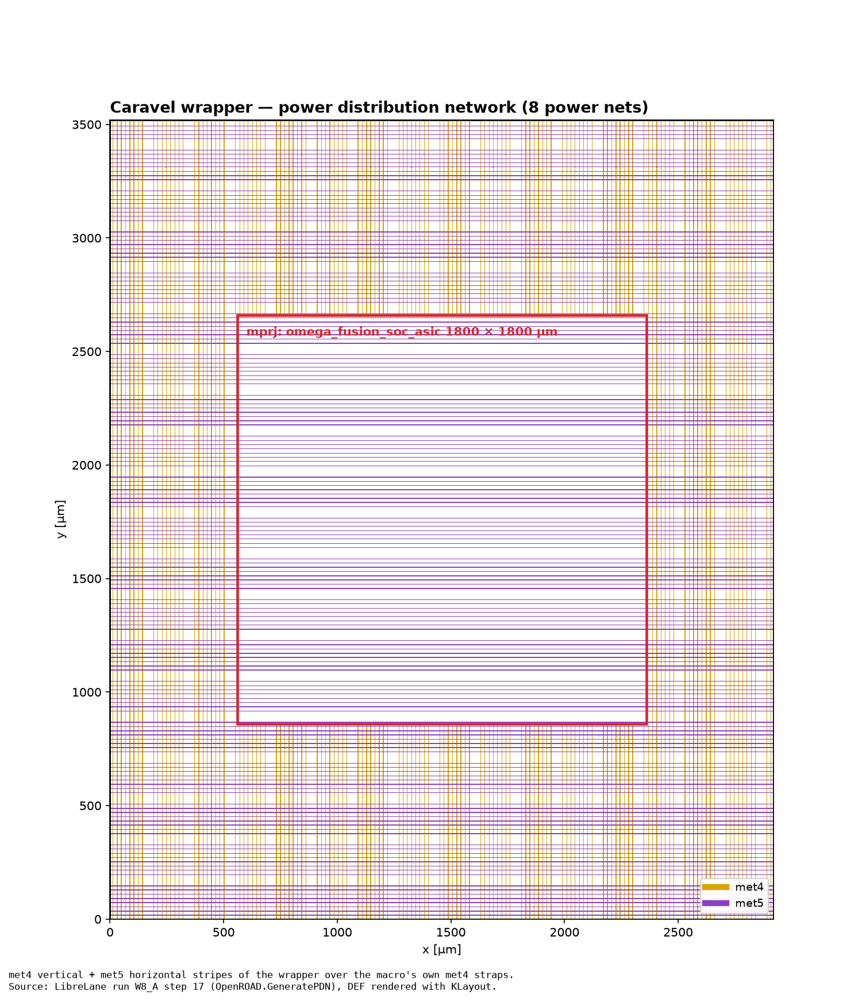 |
| **Placement** | **Detailed routing — 0 route DRC, 0 antenna** |
| 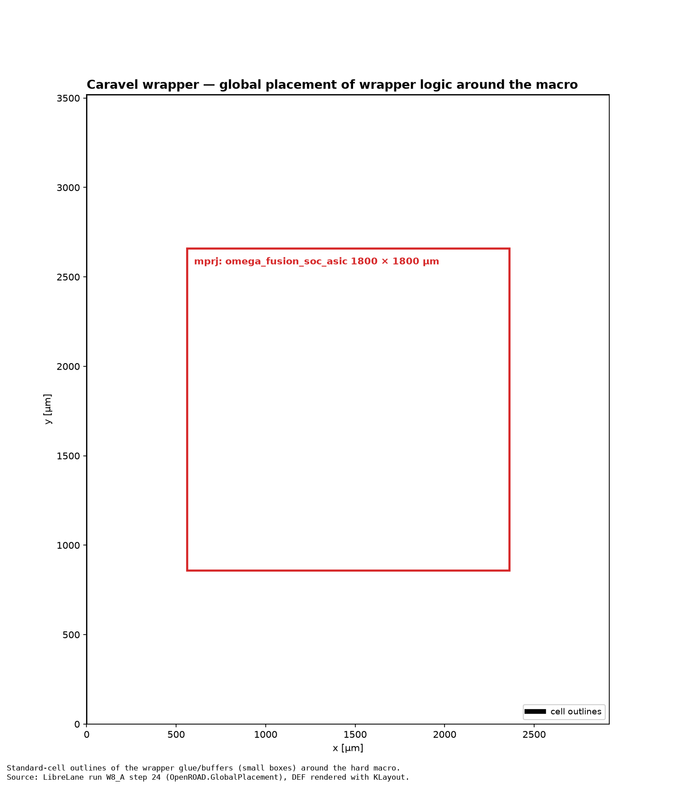 |  |

Wrapper results: route DRC 0 · antenna 0 · Magic DRC 0 · GDS XOR 0 · setup and hold met in all 9 corners · static IR drop 72 µV. *(Images: macro flipped to face the I/O, orientation `FS`; Magic DRC and XOR were run on the full wrapper GDS of the same macro at orientation `N`. Details: [`docs/results/WRAPPER_SIGNOFF_V7.md`](docs/results/WRAPPER_SIGNOFF_V7.md).)*

---

## 4. Architecture and RTL


| Module | Role |
|---|---|
| [`omega_fusion_soc_asic`](rtl/soc/omega_fusion_soc_asic.sv) | Synthesis top: instruction memory + CPU + MMIO decode + accelerator |
| [`omega_rv32_controller`](rtl/cpu/omega_rv32_controller.sv) | Single-cycle RV32I-subset core (LUI ADD ADDI SLLI ANDI LW SW BEQ BLT JAL), 32×32 register file |
| [`omega_fusion`](rtl/accelerators/omega_fusion.sv) | Accelerator front-end: MMIO registers, operand scratchpad, DMA loader, FSM, IRQ |
| [`omega_fusion_mac_folded`](rtl/accelerators/omega_fusion_mac_folded.sv) | 16 lanes × 4 accumulate steps: a 4× reduction of multiplier operators (64 → 16) |
| [`omega_wb_bridge`](caravel/rtl/omega_wb_bridge.v) | Wishbone adapter for Caravel |

Design highlights: programmable 256×32 instruction memory loaded over the bus, INT8 and INT4 signed matrix multiply, 8-word DMA loader, sticky error flag, level IRQ.

## 5. Verification

| Check | Result |
|---|---|
| Python reference — 4,000 random INT4/INT8 tiles | PASS |
| Firmware instruction-level emulator | PASS |
| Directed accelerator test (`FOLDED=0` and `FOLDED=1`): 8 matrix cases, 128 outputs, INT8/INT4, host and DMA | PASS |
| SoC demo: program in IMEM → CPU → MMIO MAC → IRQ | PASS |
| Caravel wrapper lint, Wishbone bridge/DMA, wrapper→SoC end to end | PASS |
| **Gate-level simulation of the post-route netlist** | PASS |

Logs: [`verification/`](verification/).

---

## 6. Roadmap

OMEGA-Fusion is built to keep growing; each step below is scoped and has its scripts already in place.

| Improvement | Why it makes the product better |
|---|---|
| **Buffering ECO in the macro channels of the wrapper** | Closes the wrapper's electrical limits (slew / cap / fanout) with the flipped-macro floorplan |
| **Fanout polish on the last net** (`net2070`) | Brings the macro to 0 on all three electrical limits |
| **Wrapper LVS, formal equivalence (EQY), SDF gate-level simulation** | Completes full-chip sign-off before a shuttle submission |
| **Efabless precheck** | Final gate for submission |
| **SRAM macro for instruction memory** | Frees the die: flip-flop memory is the biggest part of the cell count |
| **Higher utilization (27.9 % today)** | Smaller die, same timing — routing headroom is ample |
| **Pipeline, CSRs/traps, ISA conformance suite** | Turns the teaching-size core into a fuller RV32I |
| **Side-by-side folded vs parallel MAC in silicon** | Measures the area/energy benefit of the 4× operator folding |

Machine-readable status: [`docs/results/FINAL_STATUS.json`](docs/results/FINAL_STATUS.json) · checklist: [`docs/results/PENDING_VERIFICATION.md`](docs/results/PENDING_VERIFICATION.md).

---

## 7. Reproduce

```bash
git clone https://github.com/Josemedinan/OMEGA-Fusion.git && cd OMEGA-Fusion

bash scripts/run_all.sh                                     # RTL regression (Verilator >= 5)
PDK_ROOT=$HOME/.ciel bash scripts/run_gate_level_sim.sh     # gate-level simulation of the final netlist
( cd deliverables/v7 && shasum -a 256 -c SHA256SUMS.txt )   # verify deliverables

# open the GDS (release asset, sha256 in docs/RELEASE_ASSETS.md)
gunzip -k omega_fusion_soc_asic_V7.gds.gz && klayout omega_fusion_soc_asic_V7.gds
```

Physical flow, versions and details: [`physical_design/README.md`](physical_design/README.md), [`docs/methodology/reproduction.md`](docs/methodology/reproduction.md).

## 8. Repository map

```text
rtl/{cpu,accelerators,soc}   synthesizable SystemVerilog
tb/ · verification/          testbenches and logs
firmware/                    demo program + C MMIO header
physical_design/             LibreLane configs, SDC, ECO and plotting scripts, sign-off reports
caravel/                     wrapper RTL, config, macro placement
deliverables/                GDS, LEF, netlists, SDC + SHA-256 manifests (final layout in deliverables/v7/)
charts/ · visuals/           charts + real layout captures (macro and Caravel wrapper)
docs/                        architecture, methodology, results, presentation, full technical notes
```

Presentation (18 slides): [`docs/results/OMEGA_Fusion_V7_presentation.pdf`](docs/results/OMEGA_Fusion_V7_presentation.pdf) · Full technical notes: [`docs/archive/README_full_technical_notes.md`](docs/archive/README_full_technical_notes.md) · Sign-off reports: [`docs/results/`](docs/results/)

**License:** Apache-2.0 ([`LICENSE`](LICENSE)). See also [`CONTRIBUTING.md`](CONTRIBUTING.md), [`SECURITY.md`](SECURITY.md), [`CHANGELOG.md`](CHANGELOG.md).
