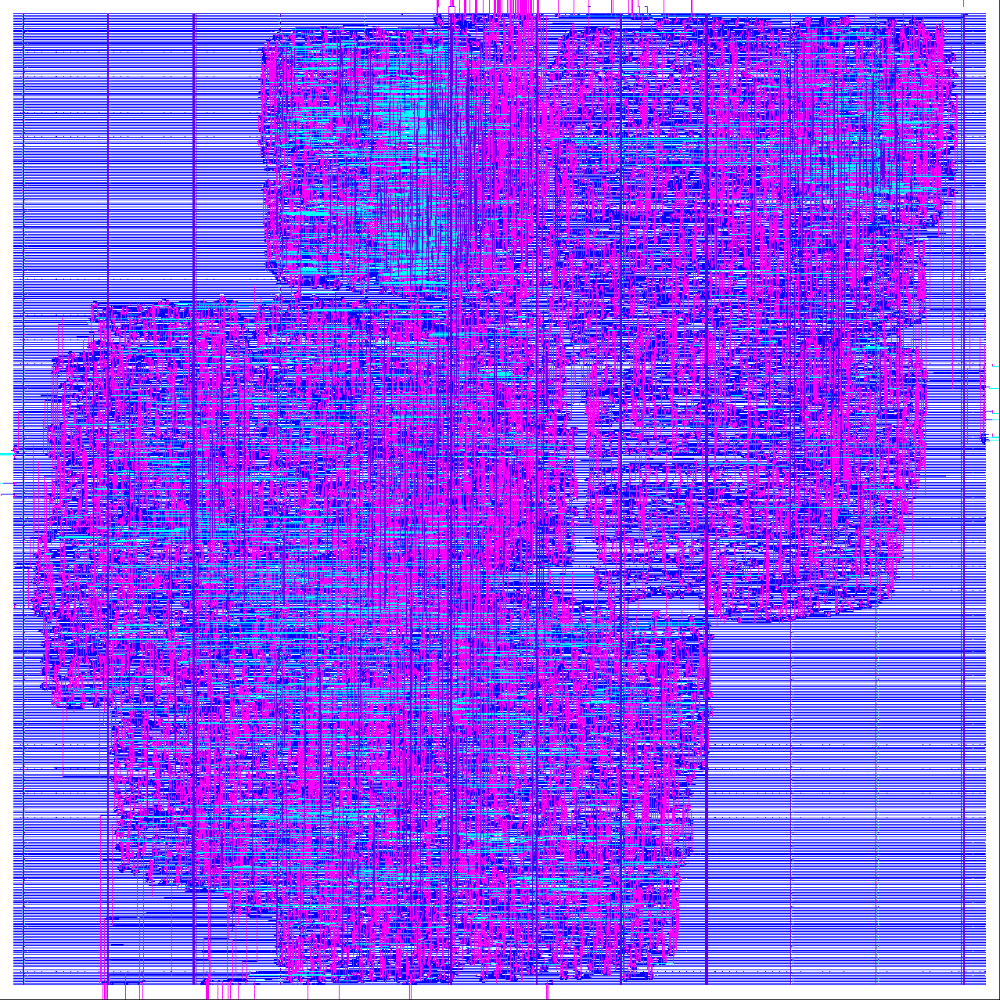
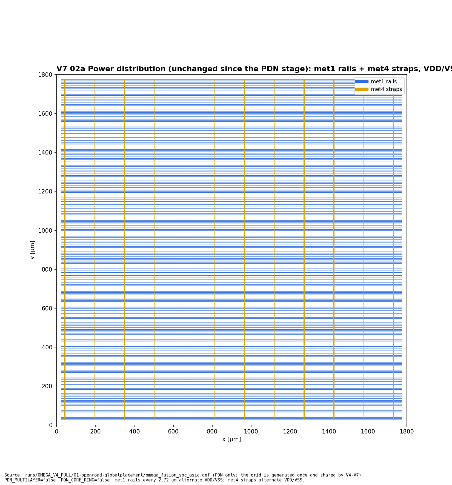
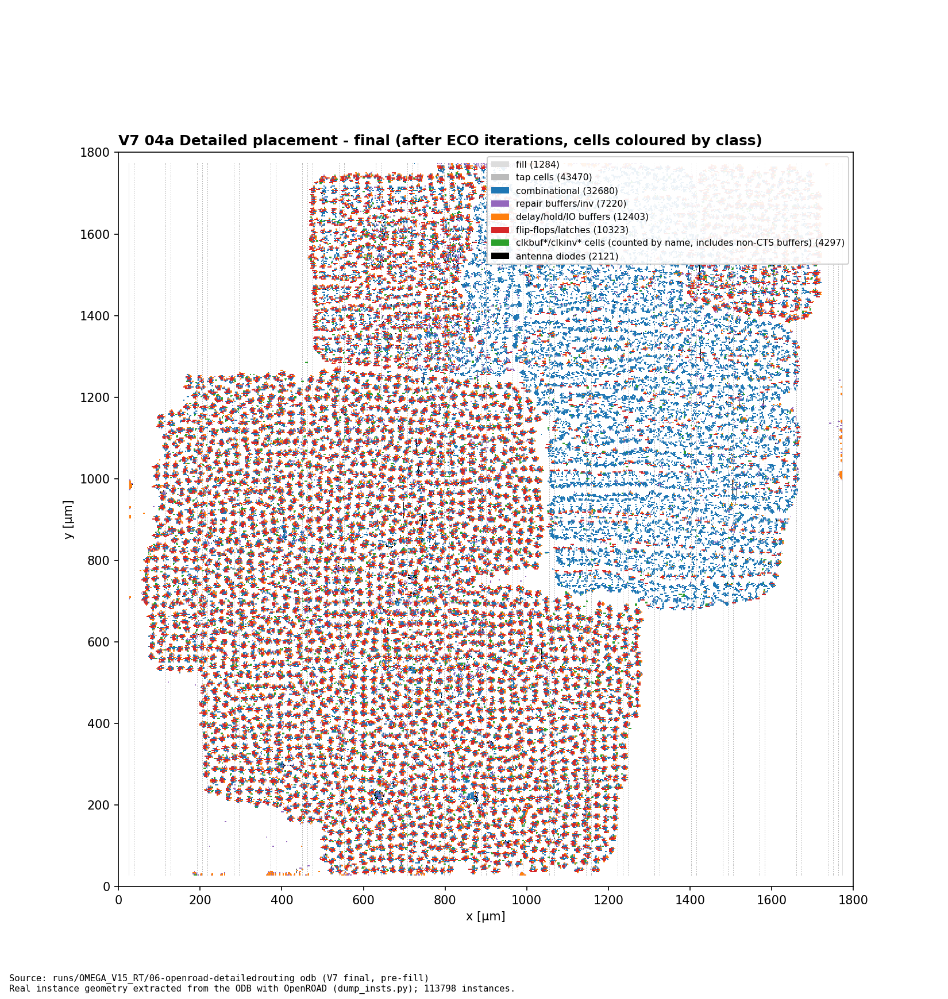
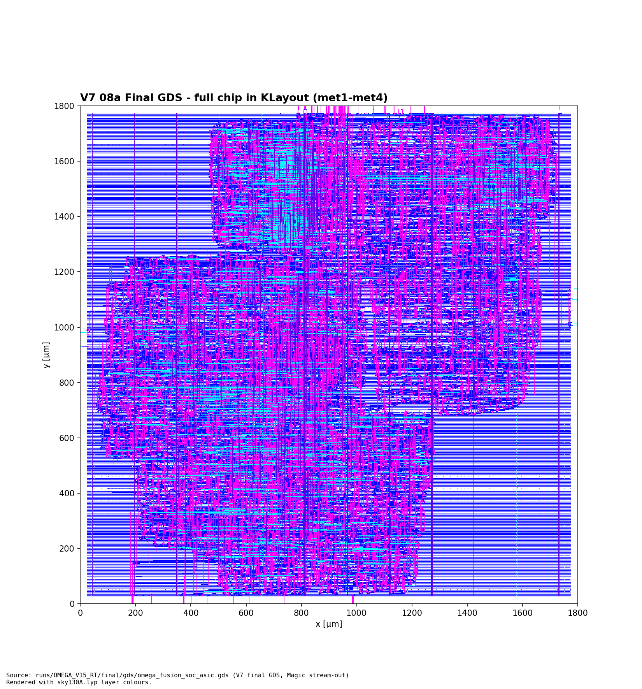
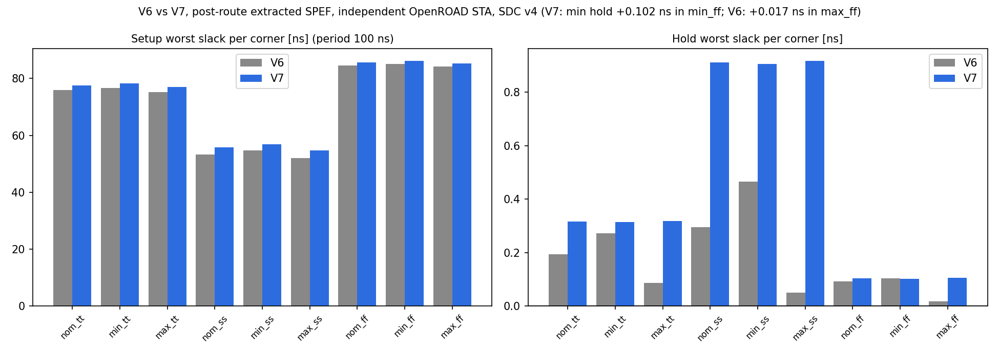
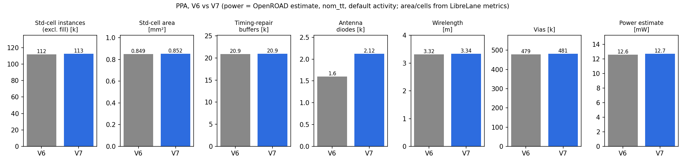
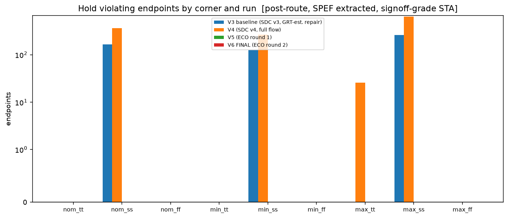
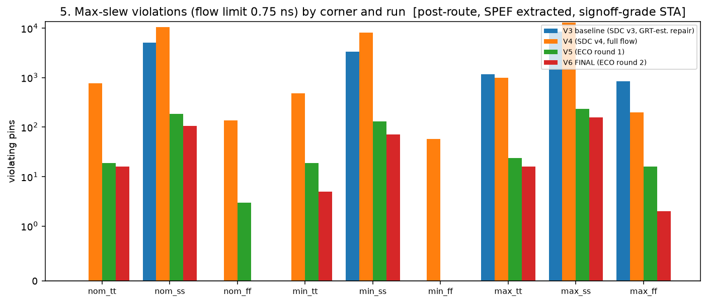
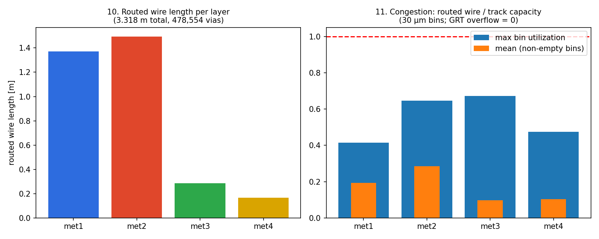
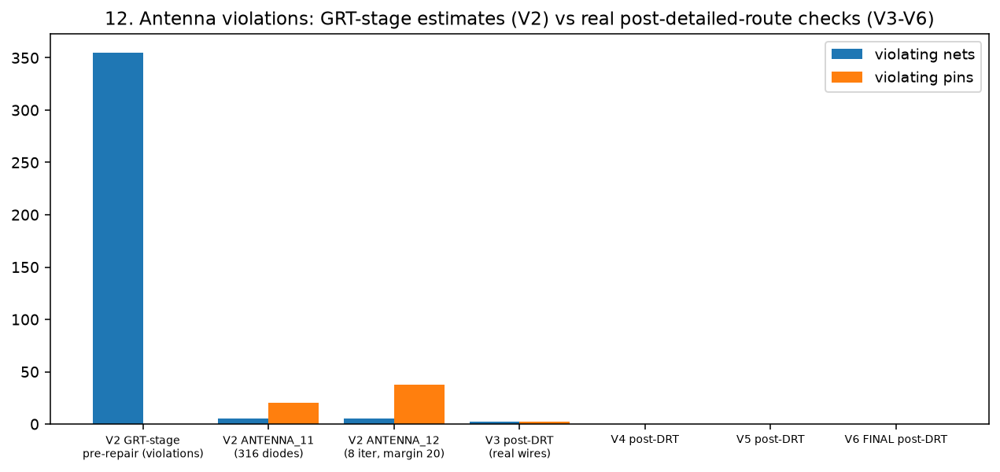

# OMEGA-Fusion — RV32I-subset SoC with an INT4/INT8 Matrix Accelerator | RTL-to-GDSII on SKY130

<p align="center">
  
</p>
<p align="center"><em>Final routed layout (GDSII, met1–met4, sky130A layer colours) of <code>omega_fusion_soc_asic</code> — SkyWater SKY130A, <code>sky130_fd_sc_hd</code>, 1800 × 1800 µm die. Phase: post-route, <b>V7</b> (V6 baseline + 9 electrical-closure ECO iterations; run <code>OMEGA_V15_RT</code>); macro-level DRC/LVS/antenna/timing clean, 1 net over the fanout limit, <b>not</b> tapeout-ready (see <a href="#status">Status</a>).</em><br>
Rendered headless with KLayout 0.30.7 from the V7 GDS (release asset <code>omega_fusion_soc_asic_V7.gds.gz</code>, sha256 in <code>docs/RELEASE_ASSETS.md</code>). The V6 baseline GDS is also a release asset (image: <code>visuals/v4_v6/00_hero_v6_gds_klayout.png</code>).</p>

> **Honest title note.** The CPU is a deliberately small, single-cycle, **non-compliant RV32I subset** (10 instructions, no CSRs/traps/interrupts, no pipeline). It is not a complete RISC-V core. What is real and complete is the RTL-to-GDSII flow for the SoC around it: CPU subset + 256×32 programmable instruction memory + INT4/INT8 4×4 matrix accelerator, taken through synthesis, placement, CTS, routing, ECO, DRC, LVS, antenna and multi-corner STA with extracted parasitics.

## <a id="status"></a>Status in one screen

**Two verified layouts are kept.** **V6** is the verified baseline (`docs/results/SIGNOFF_REPORT.md`). **V7** is the current candidate: V6 plus nine ECO/re-route iterations that closed slew, capacitance and hold margin (`docs/results/V7_ECO_REPORT.md`). Unless a row says otherwise, the table is about **V7**.

| | Result | Evidence |
|---|---|---|
| Macro layout DRC (Magic, KLayout, TritonRoute) | **PASS** — 0 / 0 / 0 (V6: same) | `physical_design/reports/v7/` |
| LVS (Netgen) | **PASS** — circuits match uniquely, 68,162 devices / 67,003 nets (V6: 67,494 devices) | `physical_design/reports/v7/lvs/` |
| GDS integrity (Magic vs KLayout XOR) | **PASS** — 0 differences | `physical_design/reports/v7/metrics.json` |
| Antenna after detailed routing | **PASS** — 0 nets / 0 pins | `…/v7/antenna/antenna_after_drt.log` |
| Setup / hold, 9 PVT-RC corners, extracted SPEF | **PASS** — worst setup +54.67 ns, worst hold **+0.102 ns** (V6: +0.017 ns) | `…/v7/sta_multicorner_summary.rpt`, `…/v7/sta/` (independent run agrees) |
| Max slew / cap vs. flow limits (0.75 ns / 0.2 pF) | **PASS** — 0 / 0 in all 9 corners (V6: 158 / 23 FAIL) | same |
| Max fanout vs. flow limit (10) | **FAIL** — 1 net (`net2070`: 10 gates + 1 antenna diode = 11 loads); V6: 83 nets | `docs/results/V7_ECO_REPORT.md` |
| Caravel: wrapper PDN with the **V7** macro (PSM connectivity of all 8 power nets) | **PASS** — stage-only run `WRAP_V7_PDN`; no PSM-0038/0039/0069 | `physical_design/reports/caravel_v7/pdn_generatepdn_v7.log` |
| Caravel: wrapper placement/routing DRC, antenna (V6 macro only) | route DRC **PASS**, antenna 1 net **FAIL** — not re-run with V7 | `docs/results/CARAVEL_INTEGRATION_REPORT.md` |
| Caravel: wrapper antenna | **FAIL** — 1 net | same |
| Caravel: wrapper DRC/LVS, closed wrapper STA | **UNVERIFIED** (not run: 8 GB host ran out of memory) | same |
| Gate-level simulation of the V7 netlist (zero delay) | **PASS** | `verification/gate_level_sim_v7.log` |
| Formal equivalence, SDF gate-level simulation, shuttle pre-check | **UNVERIFIED** (not run) | `docs/results/FINAL_STATUS.json` |
| **TAPEOUT_READY** | **NO** | `docs/results/SIGNOFF_REPORT.md` |

A GDSII file is a layout, not a chip: nothing here has been fabricated or submitted for fabrication.

## Key figures

| Item | Value | Source |
|---|---|---|
| PDK / library | SKY130A (ciel `8afc8346…`), `sky130_fd_sc_hd` | `docs/methodology/tool_versions_container.txt` |
| CPU | single-cycle RV32I **subset** (LUI ADD ADDI SLLI ANDI LW SW BEQ BLT JAL), 32×32 regfile | `rtl/cpu/omega_rv32_controller.sv` |
| Memory | 256×32 instruction RAM in flip-flops (no SRAM macro) | `rtl/soc/omega_fusion_soc_asic.sv` |
| Accelerator | 4×4 INT8/INT4 signed matmul, 16 lanes × 4 steps (folded), MMIO + 8-word DMA loader | `rtl/accelerators/` |
| Target clock | 10 MHz (100 ns) | `physical_design/constraints/soc_constraint_omega_v4.sdc` |
| Die / core | 1800 × 1800 µm (3.24 mm²) / 3.055 mm² | `metrics.json` |
| Instances (V7) | 112,514 (incl. 43,470 tap cells) + 619,218 fill cells; 10,323 flip-flops (V6: 111,661 + 619,567) | `physical_design/reports/v7/metrics.json` |
| Standard-cell area / utilization (V7) | 0.852 mm² / 27.9 % (V6: 0.849 mm² / 27.8 %) | same |
| Clock-tree cells (TritonCTS as built) | 2,168 buffers + 102 inverters (the V7 ECO added 22 clock-path buffers on top) | same |
| Timing-repair buffers (V7) | 20,940 (10,087 hold buffers); antenna diodes 2,121 (V6: 1,598) | same |
| Wirelength / vias (V7) | 3.335 m / 481,234 (all single-cut) | same |
| Power (estimate, nom_tt, default activity) | 12.7 mW | same — an estimate, not a measurement |
| Worst setup / hold slack (V7) | +54.67 ns (max_ss) / +0.102 ns (min_ff) | `…/v7/sta_multicorner_summary.rpt`; independent STA `…/v7/sta/*.summary.txt` agrees |
| Reset recovery / removal (`rst_n`, V7) | +88.7 ns / +0.466 ns | `…/v7/sta/*recovery.rpt`, `*removal.rpt` |

The die is only 27.9 % utilized: this made routing and antenna closure easy but is area-inefficient. The 1800 × 1800 µm outline was kept as originally specified.

## Architecture


Every block above exists in the RTL; nothing implied by the diagram is missing from the source. Absent on purpose: pipeline, caches, AXI/AHB, DMA arbiter, CSR/trap handling, SRAM macro. `irq` is a level output of the accelerator, not an interrupt input to the CPU. Details: [`docs/architecture/`](docs/architecture/).

## RTL design

| Module | File | Role |
|---|---|---|
| `omega_fusion_soc_asic` | [`rtl/soc/omega_fusion_soc_asic.sv`](rtl/soc/omega_fusion_soc_asic.sv) | Synthesis top: IMEM + CPU + MMIO decode + accelerator |
| `omega_rv32_controller` | [`rtl/cpu/omega_rv32_controller.sv`](rtl/cpu/omega_rv32_controller.sv) | single-cycle RV32I subset, halts on illegal instruction |
| `omega_fusion` | [`rtl/accelerators/omega_fusion.sv`](rtl/accelerators/omega_fusion.sv) | MMIO registers, operand scratchpad, DMA loader, FSM |
| `omega_fusion_mac_folded` | [`rtl/accelerators/omega_fusion_mac_folded.sv`](rtl/accelerators/omega_fusion_mac_folded.sv) | 16 lanes, one multiplier per lane, 4 accumulation steps (used in the ASIC) |
| `omega_fusion_mac` | [`rtl/accelerators/omega_fusion_mac.sv`](rtl/accelerators/omega_fusion_mac.sv) | 64-multiplier combinational variant (`FOLDED=0`, simulation only) |
| `omega_wb_bridge` | [`caravel/rtl/omega_wb_bridge.v`](caravel/rtl/omega_wb_bridge.v) | Wishbone adapter for the Caravel wrapper |

Design decisions, with their costs:

* **Programmable instruction RAM instead of a fixed ROM.** A ROM baked into the netlist lets synthesis prune parts of the datapath. The writable 256×32 array is loaded through `imem_we/imem_waddr/imem_wdata` while `run=0`. Cost: it is built from flip-flops (10,323 flops in total), which dominates the cell count; an SRAM macro is the obvious next step.
* **Folded MAC (`FOLDED=1`).** Four sequential steps per output instead of four parallel products:
  ```systemverilog
  // rtl/accelerators/omega_fusion_mac_folded.sv — per output lane, one multiplier, 4 accumulate steps
  c_flat[j*ACC_W+:ACC_W] <= $signed(c_flat[j*ACC_W+:ACC_W]) + term[j];
  ```
  This cuts multiplier *operators* 4× (64 → 16). It was **not** measured against the parallel variant in silicon area or energy: both were not taken through the physical flow side by side.
* **INT4 mode** sign-extends the low nibble of each byte rather than packing two operands per byte.
* **Host interface** is a plain one-cycle MMIO bus (`bus_ready = bus_valid`), not AXI/AHB; accesses are word-aligned, writes during `busy` raise a sticky error flag. Register map: [`docs/architecture/omega_fusion_architecture.md`](docs/architecture/omega_fusion_architecture.md).
* **Hazards / pipeline:** none to describe — the CPU is single-cycle with combinational instruction fetch.

## Verification

Run with Verilator 5.053 and Icarus Verilog (oss-cad-suite build) on 2026-11-13 from this repository layout ([`verification/rtl_regression.log`](verification/rtl_regression.log); gate level: [`verification/gate_level_sim_v7.log`](verification/gate_level_sim_v7.log) for V7, [`verification/gate_level_sim.log`](verification/gate_level_sim.log) for V6):

| Check | Result |
|---|---|
| Python reference: 4,000 random INT4/INT8 tiles | PASS (software oracle only) |
| Firmware emulator (instruction-level) | PASS — 124 instructions, C[0,0]=4 |
| Verilator lint (3 tops) | completes; 1 non-fatal warning (`PINMISSING` in a testbench instance) |
| Directed accelerator test, `FOLDED=0` and `FOLDED=1` | PASS — 8 matrix cases, 128 outputs, INT8/INT4, host/DMA, IRQ and error paths |
| SoC demo and ASIC SoC (programmed IMEM → CPU → MMIO MAC) | PASS — C[0,0]=4, IRQ=1 |
| Caravel wrapper lint, Wishbone bridge/DMA test, wrapper→SoC end-to-end | PASS |
| **Gate-level simulation of the V7 post-route netlist** (and of the V6 one; zero delay, functional cell models) | PASS — same test as RTL |
| SDF back-annotated gate-level simulation | **not run** |
| Formal equivalence (RTL vs netlist) | **not run** |

Test depth is modest: one firmware program, one directed accelerator test with 8 cases, and a random-tile software oracle. There is no ISA conformance suite, coverage measurement or constrained-random RTL regression. The CPU is not claimed to pass any RISC-V compliance test.

## Physical Macro Implemented ≠ Full SoC Tapeout Verified

| | **Physical macro implemented** (this repository) | **Full SoC tapeout verified** (not reached) |
|---|---|---|
| Scope | the `omega_fusion_soc_asic` macro, 1800×1800 µm, as a routed GDSII | macro inside the Caravel `user_project_wrapper` (2920×3520 µm), all signoff on the full chip |
| Evidence | V7: DRC, LVS, XOR, antenna, 9-corner STA, gate-level simulation (see [Status](#status)) | wrapper DRC/LVS/antenna/STA, formal equivalence, SDF simulation, shuttle pre-check |
| State | **done**, with 1 net over the fanout rule | **not done** — `TAPEOUT_READY = NO` |

## RTL-to-GDSII

Flow: LibreLane 3.0.11 (Classic) → Yosys 0.62 · OpenROAD `dcf36133a3` · TritonCTS · TritonRoute · Magic 8.3.623 · KLayout 0.30.7 · Netgen 1.5.316, resumable per stage. The V7 layout is the V6 baseline plus nine ECO/re-route iterations (run `OMEGA_V15_RT`, 2026-11-13). Root-cause analyses: [`docs/physical_design/PHYSICAL_DESIGN_REPORT.md`](docs/physical_design/PHYSICAL_DESIGN_REPORT.md), [`docs/results/V7_ECO_REPORT.md`](docs/results/V7_ECO_REPORT.md). Every image below states its version in its title; stages that were run once and are shared by V4–V7 (floorplan, PDN, global placement) say so.

| Stage | What was done (V7 numbers where they changed) |
|---|---|
| Synthesis | Yosys → 43,448 cells; IMEM and register file map to flip-flops/muxes (no SRAM macro) |
| Floorplan | die 1800×1800 µm, core 3.055 mm², 179 pins, 43,470 tap cells (shared V4–V7) |
| PDN | met1 rails + met4 straps, VDD/VSS, no ring; IR drop 0.09 mV (V6 run) |
| Placement | global (V4 base run) → legalized, then ECO-modified in V7: 112,514 instances, 27.9 % utilization |
| CTS | TritonCTS: 2,168 buffers + 102 inverters for 10,323 sinks; V7 added 22 clock-path buffers |
| Routing | global overflow 0 → TritonRoute, route DRC 0, 3.335 m wire, 481,234 single-cut vias; antenna repair → 0 violations |
| Signoff | Magic/KLayout DRC 0, Netgen LVS match, XOR 0, 9-corner STA |

<table>
<tr><th>Floorplan — V7 (shared V4–V7)</th><th>Power grid — V7 (shared V4–V7)</th></tr>
<tr><td><br>Die, core, pin sides. <i>Checkpoint: V4 base run /01, OpenROAD geometry + matplotlib, 2026-11-13.</i></td>
    <td><br>Rails and straps alternate VDD/VSS. <i>PDN-only DEF; KLayout.</i></td></tr>
<tr><th>Global placement — V4 base run</th><th>Detailed placement — V7 final</th></tr>
<tr><td><br>The starting point (not the V7 final). Flip-flop arrays left/bottom, datapath logic top-right.</td>
    <td><br>Final legalized placement after the ECO iterations. <i>Run OMEGA_V15_RT/06.</i></td></tr>
<tr><th>Placement density — V7</th><th>Clock network — V7</th></tr>
<tr><td><br>Cell area / 30 µm bin.</td>
    <td><br>Driver→load connectivity (straight lines, not wires). Legend counts by cell name, the flow metric is authoritative.</td></tr>
<tr><th>Global routing — V7</th><th>Routing congestion — V7</th></tr>
<tr><td><br>Guides by layer, overflow 0. <i>OMEGA_V15_RT/01.</i></td>
    <td><br>Routed wire / track capacity; peak 0.41 / 0.62 / 0.70 / 0.56 (met1–met4).</td></tr>
<tr><th>Detailed routing — V7</th><th>Final GDSII — V7 core zoom</th></tr>
<tr><td><br>met1 blue, met2 red, met3 green, met4 yellow. <i>Final DEF, KLayout.</i></td>
    <td><br>120×120 µm of the signed-off GDS. <i>Magic stream-out, KLayout.</i></td></tr>
<tr><th>Final GDSII — V7 full chip</th><th>Final GDSII — V7 cell level</th></tr>
<tr><td><br>met1–met4, sky130A layer colours.</td>
    <td><br>22×22 µm: diffusion, poly, li1, mcon, met1.</td></tr>
</table>

Sources, tools and caveats of every image: [`docs/results/VISUAL_GALLERY.md`](docs/results/VISUAL_GALLERY.md). The older V4/V6 image set remains in [`visuals/`](visuals/) and is labeled as such in the gallery.

## Physical results


**V6 → V7.** Nine ECO/re-route iterations (each measured post-route with extracted SPEF): hold margin went from +17 ps to +102 ps, slew violations 158 → 0, capacitance 23 → 0, fanout 83 nets → 1 net; antenna and routing DRC stayed at 0. Root causes (clock-tree nodes, weak drivers on long wires, antenna diodes stranded away from their driver, diodes counted as fanout) and the iteration table: [`docs/results/V7_ECO_REPORT.md`](docs/results/V7_ECO_REPORT.md). The charts below that are not marked V7 show the **V6 baseline** and the earlier runs.

| | |
|---|---|
|  |  |
| **Setup/hold per corner, V6 vs V7** (independent STA, extracted SPEF). Big hold gains in max_ff and the SS corners; in min_ff V7 is 2 ps *below* V6 (+0.1018 vs +0.1037 ns). | **PPA, V6 vs V7.** Area +0.3 %, 20,940 vs 20,875 timing-repair buffers, 2,121 vs 1,598 antenna diodes; power is an estimate. |
|  |  |
| **Setup slack, 9 corners — V6.** Large margin at 10 MHz: worst +52.0 ns in max_ss (V7: +54.7 ns). | **Hold slack, 9 corners — V6.** All ≥ 0 but thin: +17 ps in max_ff (V7: ≥ +102 ps in every corner). |
|  |  |
| **Hold violations by run (to V6).** V3 −0.605 ns (260 endpoints, max_ss) → V4 −1.198 ns → V5/V6 ≥ 0 after ECO with real SPEF. | **Slew violations by run (to V6).** 12,908 (V4) → 231 → 158 (V6); V7 reaches 0 (chart above). |
|  |  |
| **Clock skew by corner.** Insertion delay is 3.3–5.2 ns in SS, which is what made input hold hard against the 2 ns input delay. | **Layer usage and congestion — V6.** Routing is mostly met1/met2; peak bin utilization 0.42/0.65/0.67/0.47 (met1–met4); V7: 0.41/0.62/0.70/0.56 (`charts/data/congestion_by_layer_v7.csv`). |
|  |  |
| **Antenna evolution (to V6).** 5 nets / 20–38 pins at GRT-stage repair → 0 after the final detailed route; V7: 184 nets before repair → 0 after. | **PPA summary — V6.** Area, power (estimate), indicative fmax per corner, cell counts. |

More charts (area/instances/buffers by stage, cap and fanout violations, wirelength, DRC/LVS/antenna summary, IR drop, 11 vs 12 antenna variants) are in [`charts/`](charts/) with their CSV/JSON data in [`charts/data/`](charts/data/).

**What the numbers do and do not say**

* The timing margins are real *for this SDC*. The first SDC (v2) only had a clock and I/O delays: with a custom `PNR_SDC_FILE` LibreLane does not apply its `base.sdc`, so limits, driving cell, load, uncertainty and derate were missing, and `rst_n` had no input delay (recovery/removal unconstrained). SDC v4 adds them; none of the limits was relaxed afterwards.
* V7 meets slew and capacitance in all 9 corners with the flow's own limits (0.75 ns / 0.2 pF), also confirmed by an independent STA script; with Liberty-only limits (no `set_max_*` in the SDC) all four checked corners show 0/0/0. One net still has 11 loads against the limit of 10 (10 gates plus 1 antenna diode): reported as FAIL. It kept coming back because every re-route lets the antenna repair put diodes back on nets that sit at the limit.
* V7 hold slack is ≥ +102 ps in every corner (V6: +17 ps), but it was obtained by adding delay buffers (20,940 timing-repair buffers in total); 5 % derate and 0.25 ns uncertainty were already applied. It has not been checked against on-chip-variation models beyond those.
* Power is an OpenROAD estimate with default switching activity.

## Fabrication and integration — what exists and what does not

| Stage | State |
|---|---|
| Layout generated (GDSII, LEF, netlists, SPEF, SDC) | **done** — V7 in `deliverables/v7/`, V6 baseline in `deliverables/` |
| Macro physical verification (DRC, LVS, antenna, XOR Magic vs KLayout) | **passed** for both V6 and V7 |
| Electrical-limit closure (slew/cap/fanout) | V7: slew and cap **passed**, fanout **1 net open** (V6: all three open) |
| Caravel integration as `mprj` (2920×3520 µm wrapper, macro at (560, 860)) | with the **V7** macro: PDN connectivity of all 8 power nets **passed** (PDN-only run); the rest of the wrapper flow was **not** run with V7. With the **V6** macro: PDN **passed**, wrapper route DRC 0, wrapper antenna 1 net **failing**; wrapper DRC/LVS **not run** for either |
| Shuttle pre-check | **not run** |
| Fabrication | **not done, not submitted** |

SKY130 is SkyWater's open 130 nm process; `sky130_fd_sc_hd` is its high-density standard-cell library. The remaining steps before any submission are listed in [`docs/results/SIGNOFF_REPORT.md`](docs/results/SIGNOFF_REPORT.md): close the last fanout net (11 loads, 1 of them an antenna diode), run the rest of the Caravel wrapper flow with the V7 macro (only its PDN stage was run), fix the wrapper antenna, run wrapper DRC/LVS on a larger machine, then equivalence, SDF simulation and the shuttle pre-check.

## Reproduce

Detailed instructions, versions and caveats: [`docs/methodology/reproduction.md`](docs/methodology/reproduction.md).

```bash
git clone <this repository> OMEGA-Fusion && cd OMEGA-Fusion

# 1. RTL regression: Python oracles, lint, directed + SoC + Caravel-wrapper simulations
#    needs: Python 3.10+, Verilator >= 5 (--binary --timing)
bash scripts/run_all.sh

# 2. Gate-level (zero-delay) simulation of the V7 final netlist (NETLIST=deliverables/netlist/... for the V6 one)
#    needs: Icarus Verilog (tested with the oss-cad-suite build) and the SKY130A PDK (e.g. via ciel) — PDK_ROOT points at the folder containing sky130A/
PDK_ROOT=$HOME/.ciel bash scripts/run_gate_level_sim.sh

# 3. Verify deliverable integrity
( cd deliverables && shasum -a 256 -c SHA256SUMS.txt ) && ( cd deliverables/v7 && shasum -a 256 -c SHA256SUMS.txt )

# 4. Open the final GDS in KLayout
# the GDS is a release asset (not in git): download omega_fusion_soc_asic_V7.gds.gz from the GitHub Release (docs/RELEASE_ASSETS.md), verify its sha256, then
gunzip -k omega_fusion_soc_asic_V7.gds.gz && klayout omega_fusion_soc_asic_V7.gds
```

The physical flow (synthesis → GDSII) uses LibreLane 3.0.11 in Docker and is documented in [`physical_design/README.md`](physical_design/README.md). **Requirements:** ≥ 16 GB RAM and ≥ 40 GB free disk recommended. On the 8 GB MacBook Air used for this work, Docker repeatedly stalled under memory pressure and one disk-full event killed a run; the flow could be completed only by running one job at a time and resuming from saved states. Wrapper-level DRC/LVS could not be run there at all. The physical flow has **not** been re-run end-to-end from this repository layout; only the RTL regression and the gate-level simulation were re-executed from it.

## Repository layout

```text
rtl/{cpu,accelerators,soc}   synthesizable SystemVerilog
tb/{directed,regression}     testbenches (gate_level uses the regression TB with the netlist)
firmware/                    demo ROM + C MMIO header
scripts/                     simulation runners, ROM builder, Python oracle, diagram generator
verification/                logs of the runs quoted above
physical_design/             LibreLane configs, SDC, flow scripts, signoff reports
caravel/                     wrapper RTL, wrapper config, macro placement
deliverables/                gzip'd GDS, LEF, netlists, SDC + SHA-256 manifests (V6 baseline here, V7 in deliverables/v7/)
docs/                        architecture, methodology (incl. cleanup manifest), timing, results, presentation
visuals/ charts/             real captures and charts (data in charts/data)
```

Large artifacts that do not fit in git (extracted SPEF ×3 ≈ 260 MB, KLayout GDS, routed DEF, LibreLane run databases) are listed with SHA-256 in `deliverables/SHA256SUMS.original.txt` (V6) and `deliverables/v7/SHA256SUMS.original.txt` (V7).

## Industrial and academic applications

What the project can plausibly contribute (education in RISC-V and ASIC flow, open-hardware reference, embedded prototyping, PPA-methodology research, small INT4/INT8 acceleration, reproducible open EDA) — each item split into **demonstrated**, **possible next** and **needs validation**, with no performance claims: [`docs/INDUSTRIAL_APPLICATIONS.md`](docs/INDUSTRIAL_APPLICATIONS.md). No throughput, energy or silicon measurement exists.

## Release assets, presentation and provenance

* Physical release (GDS, SPEF, KLayout GDS, DEF as `.gz`, with SHA-256): [`docs/RELEASE_ASSETS.md`](docs/RELEASE_ASSETS.md). LEF, netlists and SDC are in `deliverables/`. *The assets are prepared locally; this README does not claim they are published until the GitHub Release exists.*
* Release candidate selection and file lineage (which file produced which): [`docs/results/RELEASE_CANDIDATE.md`](docs/results/RELEASE_CANDIDATE.md); the open fanout net: [`docs/results/NET2070_ANALYSIS.md`](docs/results/NET2070_ANALYSIS.md).
* Presentation (18 slides, V7 images and metrics): [`docs/results/OMEGA_Fusion_V7_presentation.pdf`](docs/results/OMEGA_Fusion_V7_presentation.pdf) (the older V6 deck is archived as `docs/results/archive_v6/OMEGA_Fusion_physical_design_presentation_V6.pdf`).
* Wrapper-level tasks that still need a large machine, with the commands: [`docs/results/PENDING_VERIFICATION.md`](docs/results/PENDING_VERIFICATION.md).

## Contributing, security, license

[`CONTRIBUTING.md`](CONTRIBUTING.md) · [`SECURITY.md`](SECURITY.md) · [`CHANGELOG.md`](CHANGELOG.md) · [`docs/LICENSES_AND_SECURITY_AUDIT.md`](docs/LICENSES_AND_SECURITY_AUDIT.md).

**License.** The original OMEGA-Fusion sources (RTL, testbenches, scripts, documentation, figures) are released under the **Apache License 2.0** (decision of the repository owner, 2026-11-13); see [`LICENSE`](LICENSE) and [`NOTICE`](NOTICE). The Caravel wrapper files (`caravel/rtl/user_project_wrapper.v`, `defines.v`, `user_defines.v`, `uprj_netlists.v`, `caravel/openlane/fixed_dont_change/*`) come from Efabless' `caravel_user_project` and are also Apache-2.0 (© Efabless Corporation). The layouts embed SkyWater SKY130 `sky130_fd_sc_hd` cells (Apache-2.0).
