# OMEGA-Fusion — RISC-V SoC + INT4/INT8 Matrix Accelerator, RTL to GDSII on SKY130

<p align="center">
  
</p>
<p align="center"><em>Final routed GDSII of <code>omega_fusion_soc_asic</code> — SkyWater SKY130A, 1800 × 1800 µm, 10,323 flip-flops, 3.3 m of wire, 481 k vias. Rendered from the real GDS with KLayout.</em></p>

**OMEGA-Fusion is a complete open-source chip-design project: from SystemVerilog to a signed-off GDSII layout.** A single-cycle RISC-V core feeds a 4×4 INT4/INT8 matrix-multiply accelerator over a memory-mapped bus; the whole SoC was synthesized, placed, clock-tree-balanced, routed, ECO-tuned, verified in 9 PVT corners with extracted parasitics, and then integrated into the Efabless **Caravel** `user_project_wrapper`.

| | |
|---|---|
| **Process / library** | SkyWater SKY130A, `sky130_fd_sc_hd` |
| **Die** | 1800 × 1800 µm (3.24 mm²), 179 pins |
| **Design size** | 112,514 instances · 10,323 flip-flops · 2,168 + 102 clock buffers/inverters |
| **Clock** | 10 MHz target — worst setup slack **+54.7 ns** |
| **Verified layout** | DRC 0 (Magic, KLayout, TritonRoute) · LVS match (68,162 devices) · XOR 0 · antenna 0 |
| **Timing** | Setup and hold met in **9/9 PVT-RC corners**; worst hold **+102 ps** |
| **Flow** | LibreLane 3.0.11 → Yosys · OpenROAD · TritonCTS · TritonRoute · Magic · KLayout · Netgen |

---

## 1. How the GDSII improved: V6 → V7

The V6 layout was already DRC/LVS-clean. **V7** takes it further with nine measured ECO + re-route iterations that touch only buffers, cell sizes, clock-path buffers and antenna diodes — never the RTL, the SDC or the limits.

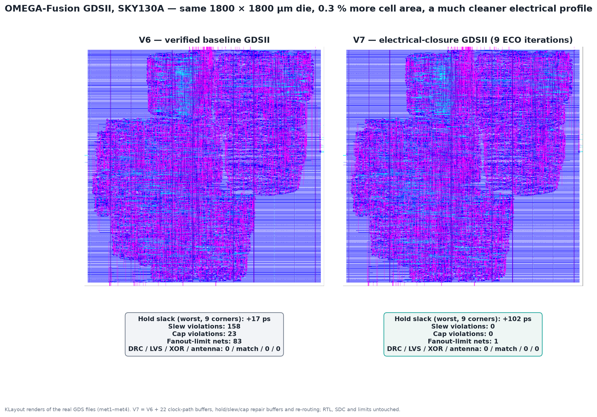

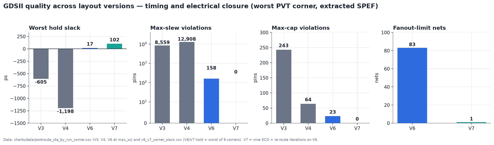

| Metric (worst PVT corner, extracted SPEF) | V3 | V4 | V6 | **V7** |
|---|---|---|---|---|
| Worst hold slack | −605 ps | −1,198 ps | +17 ps | **+102 ps** (6× more margin) |
| Max-slew violations | 8,559 | 12,908 | 158 | **0** |
| Max-cap violations | 243 | 64 | 23 | **0** |
| Fanout-limit nets | — | — | 83 | **1** |
| Cell area | | | 0.849 mm² | 0.852 mm² (+0.3 %) |

**What the ECO loop did.** Each iteration reads the routed database and the extracted SPEF of the previous one, edits the netlist locally (22 clock-path buffers, hold-fix buffers, cell up-sizing, antenna diodes), strips the routing and re-runs global routing → detailed routing → antenna repair → RCX → 9-corner STA. The result is a layout that keeps the same floorplan and the same area while gaining 6× hold margin and removing every slew and capacitance violation.

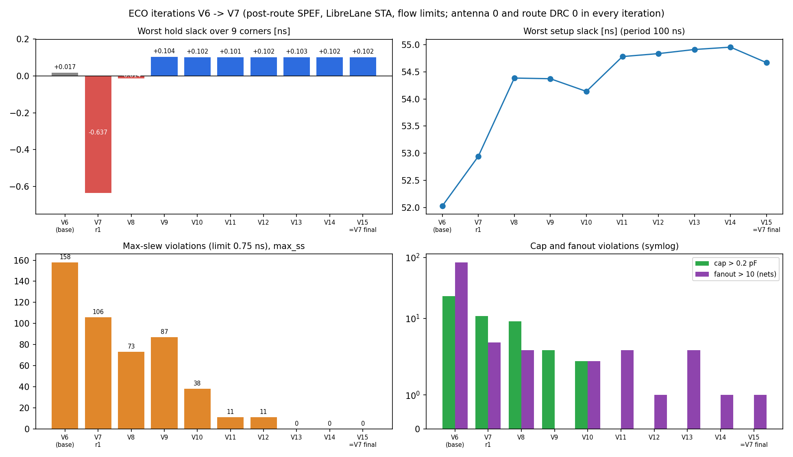

| | |
|---|---|
|  |  |
| **Setup/hold per corner, V6 vs V7** — hold margin grows in the SS and FF corners. | **PPA, V6 vs V7** — area, buffers, wirelength and vias. |

Details: [`docs/results/V7_ECO_REPORT.md`](docs/results/V7_ECO_REPORT.md).

---

## 2. Sign-off scoreboard

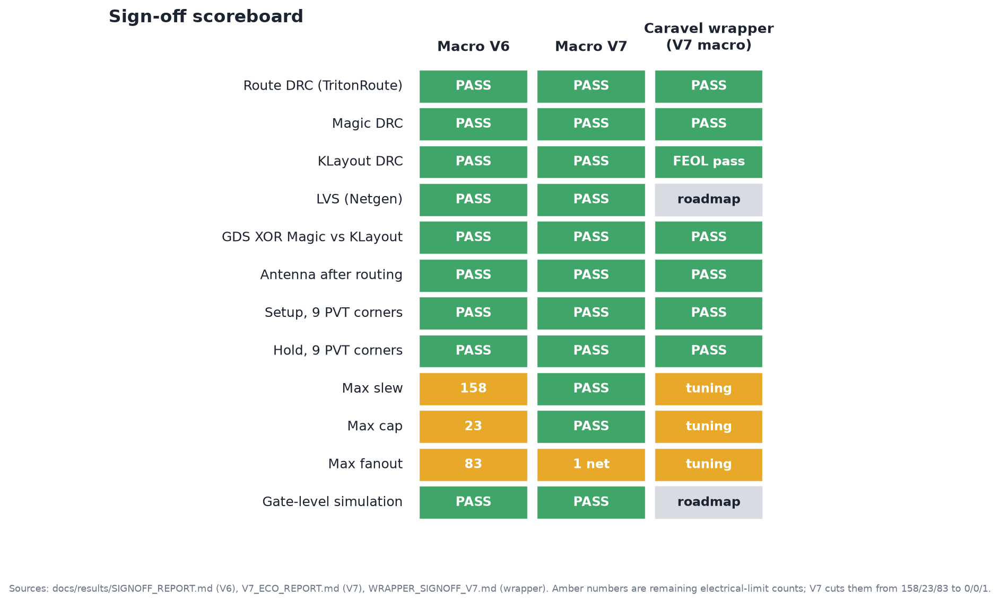

---

## 3. The physical design journey (real captures)

Every image below is generated from real physical files (ODB / DEF / GDS) — nothing is synthetic. Sources and tools per image: [`docs/results/VISUAL_GALLERY.md`](docs/results/VISUAL_GALLERY.md).

<table>
<tr><th>Floorplan</th><th>Power grid</th></tr>
<tr><td><br>Die, core and pin sides.</td>
    <td><br>met1 rails + met4 straps, alternating VDD/VSS.</td></tr>
<tr><th>Global placement</th><th>Detailed placement</th></tr>
<tr><td><br>Starting point: flip-flop arrays and datapath logic clusters.</td>
    <td><br>Legalized placement after the ECO iterations.</td></tr>
<tr><th>Placement density</th><th>Clock tree</th></tr>
<tr><td>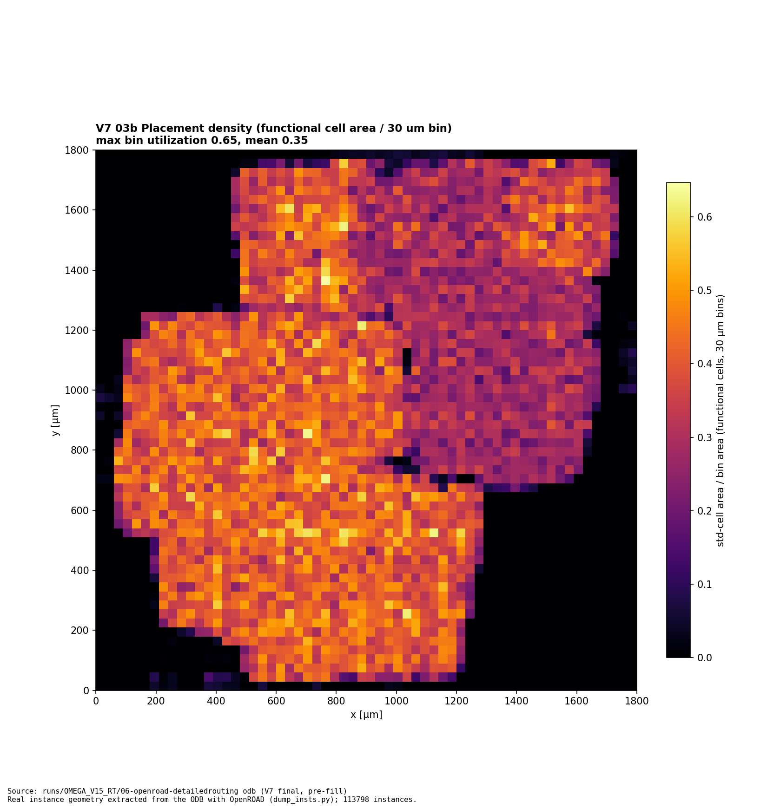<br>Cell area per 30 µm bin.</td>
    <td><br>TritonCTS: 10,323 sinks, driver→load connectivity.</td></tr>
<tr><th>Global routing</th><th>Routing congestion</th></tr>
<tr><td>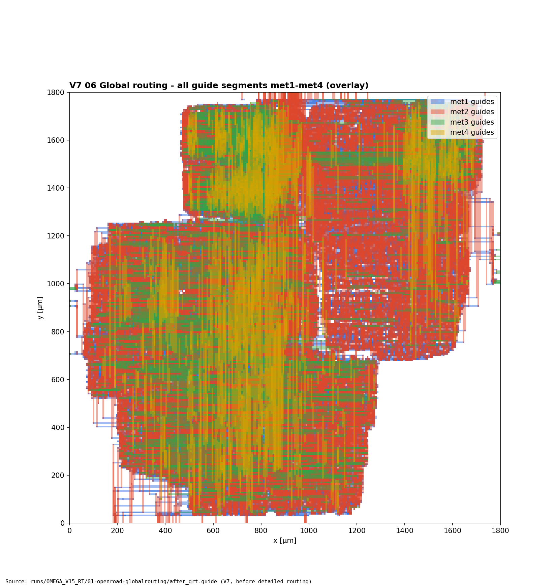<br>Routing guides by layer, overflow 0.</td>
    <td>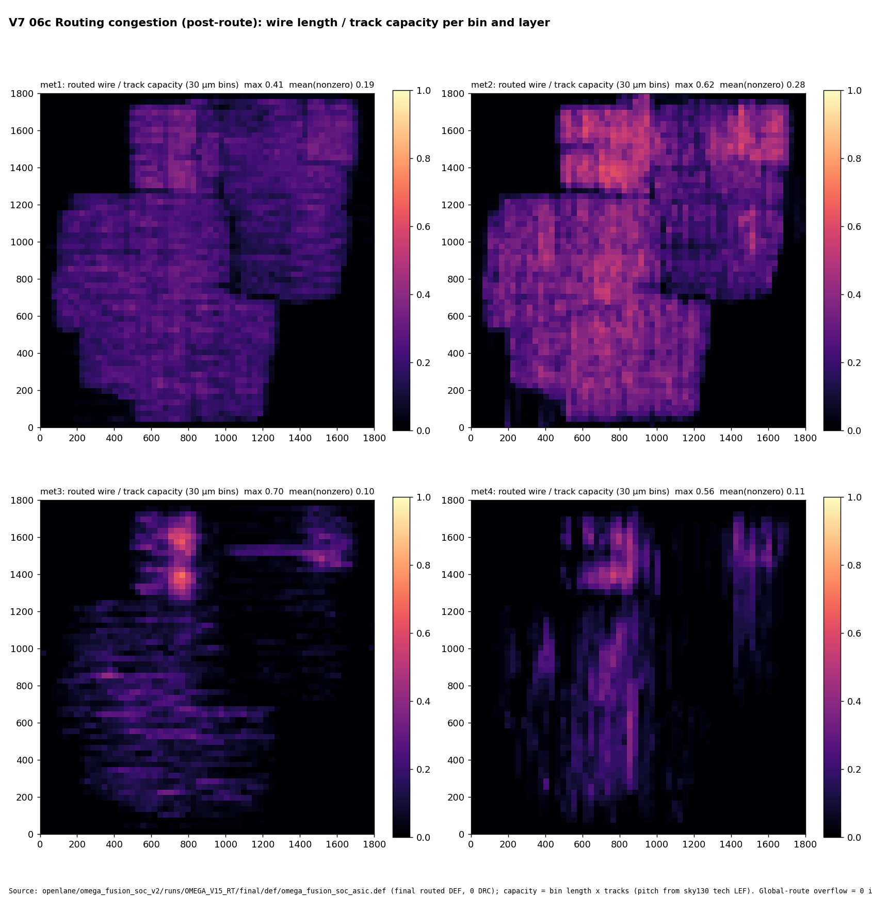<br>Peak track usage 0.41 / 0.62 / 0.70 / 0.56 (met1–met4).</td></tr>
<tr><th>Detailed routing</th><th>Final GDSII</th></tr>
<tr><td><br>met1 blue · met2 red · met3 green · met4 yellow.</td>
    <td><br>120 × 120 µm of the final GDS.</td></tr>
</table>


*22 × 22 µm of the GDSII: diffusion, poly, li1, mcon and met1 — individual standard cells.*

### Timing and electrical charts

| | |
|---|---|
| 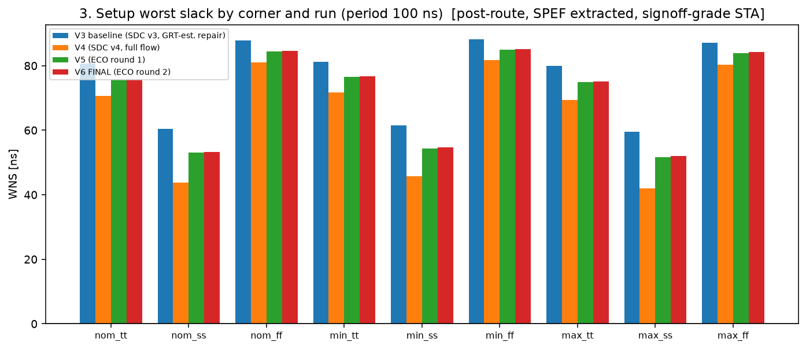 | 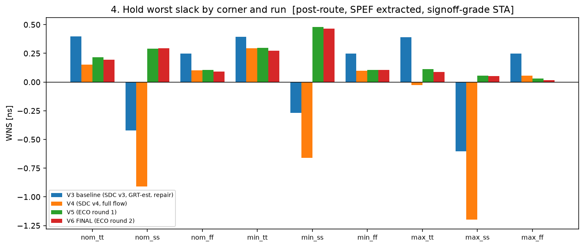 |
| **Setup slack in 9 corners** — huge margin at 10 MHz. | **Hold slack in 9 corners** — all corners met. |
| 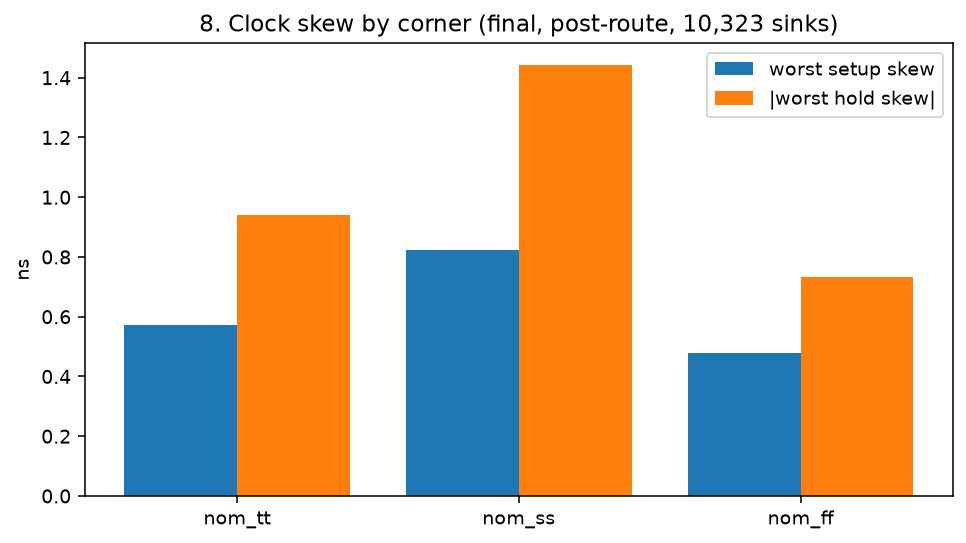 |  |
| **Clock skew by corner.** | **Layer usage and congestion.** |
|  | 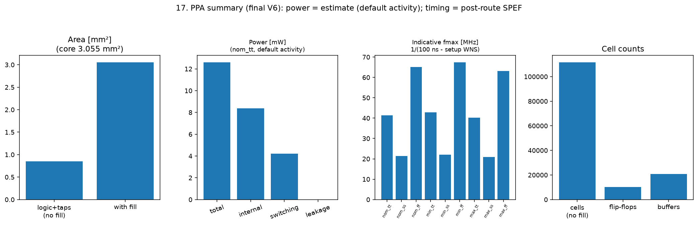 |
| **Antenna evolution** — repaired to 0 after detailed routing. | **PPA summary.** |

All charts and their CSV/JSON data: [`charts/`](charts/), [`charts/data/`](charts/data/).

---

## 4. Caravel integration

The V7 macro was dropped into the Efabless Caravel `user_project_wrapper` (2920 × 3520 µm) as `mprj`, and the full wrapper flow was run: floorplan → PDN → placement → CTS → routing → antenna repair → RCX → 9-corner STA → Magic DRC / XOR.

| Floorplan: macro faces the I/O | Power grid (8 power nets) |
|---|---|
| 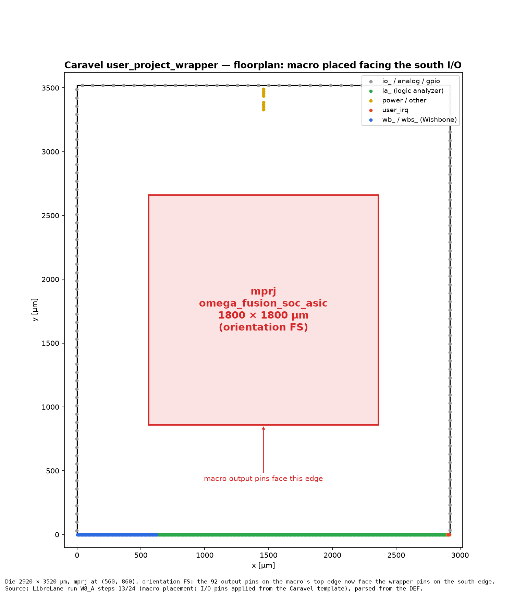 |  |
| **Placement** | **Detailed routing — 0 route DRC, 0 antenna** |
|  | 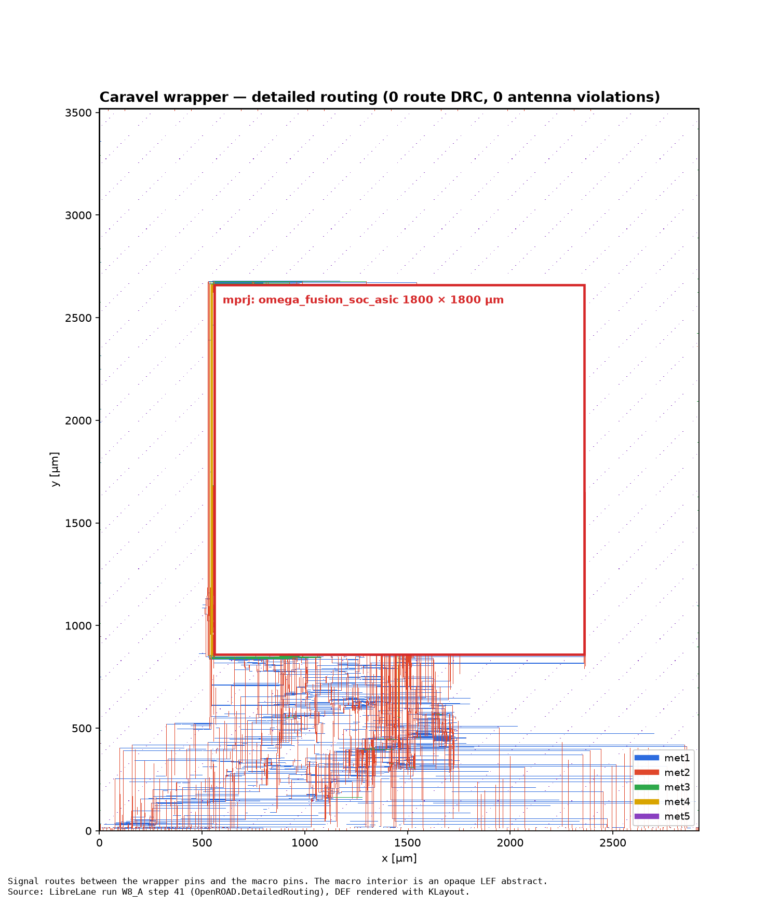 |

Wrapper results: route DRC 0 · antenna 0 · Magic DRC 0 · GDS XOR 0 · setup and hold met in all 9 corners · static IR drop 72 µV.

**Macro-placement design-space exploration.** The macro has pins on four edges while the Caravel I/O sit on the south edge, so macro orientation and position matter for wire length. Four configurations were run end to end; **flipping the macro (`FS`) cut max-slew violations by 35 %** versus the repeater-ECO baseline while keeping route DRC and antenna at 0.

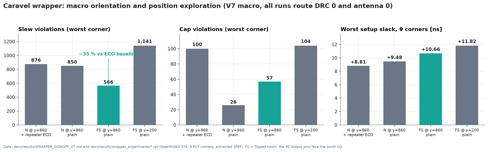

Full numbers: [`docs/results/WRAPPER_SIGNOFF_V7.md`](docs/results/WRAPPER_SIGNOFF_V7.md).

---

## 5. Architecture and RTL

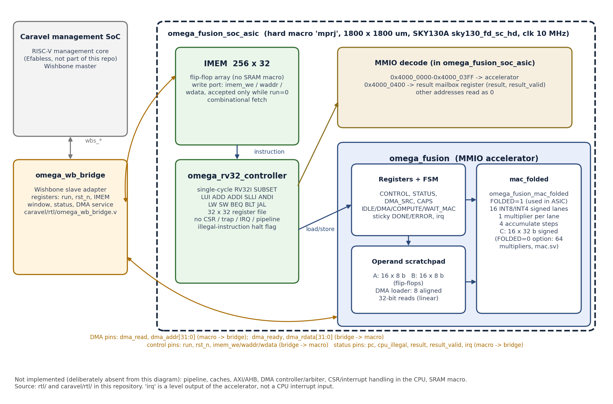

| Module | Role |
|---|---|
| [`omega_fusion_soc_asic`](rtl/soc/omega_fusion_soc_asic.sv) | Synthesis top: instruction memory + CPU + MMIO decode + accelerator |
| [`omega_rv32_controller`](rtl/cpu/omega_rv32_controller.sv) | Single-cycle RV32I-subset core (LUI ADD ADDI SLLI ANDI LW SW BEQ BLT JAL), 32×32 register file |
| [`omega_fusion`](rtl/accelerators/omega_fusion.sv) | Accelerator front-end: MMIO registers, operand scratchpad, DMA loader, FSM, IRQ |
| [`omega_fusion_mac_folded`](rtl/accelerators/omega_fusion_mac_folded.sv) | 16 lanes × 4 accumulate steps: a 4× reduction of multiplier operators (64 → 16) |
| [`omega_wb_bridge`](caravel/rtl/omega_wb_bridge.v) | Wishbone adapter for Caravel |

Design highlights: programmable 256×32 instruction memory loaded over the bus, INT8 and INT4 signed matrix multiply, 8-word DMA loader, sticky error flag, level IRQ.

## 6. Verification

| Check | Result |
|---|---|
| Python reference — 4,000 random INT4/INT8 tiles | PASS |
| Firmware instruction-level emulator | PASS |
| Directed accelerator test (`FOLDED=0` and `FOLDED=1`): 8 matrix cases, 128 outputs, INT8/INT4, host and DMA | PASS |
| SoC demo: program in IMEM → CPU → MMIO MAC → IRQ | PASS |
| Caravel wrapper lint, Wishbone bridge/DMA, wrapper→SoC end to end | PASS |
| **Gate-level simulation of the post-route V6 and V7 netlists** | PASS |

Logs: [`verification/`](verification/).

---

## 7. Roadmap — next improvements

OMEGA-Fusion is built to keep growing; each step below is scoped and has its scripts already in place.

| Improvement | Why it makes the product better |
|---|---|
| **Wrapper buffering ECO in the macro channels** | Takes the Caravel wrapper's electrical limits (slew / cap / fanout) to zero on top of the FS orientation result |
| **Fanout polish on the last V7 net** (`net2070`) | Brings the macro to 0 violations on all three electrical limits |
| **Wrapper LVS, formal equivalence (EQY), SDF gate-level simulation** | Completes full-chip sign-off before a shuttle submission |
| **Efabless precheck** | Final gate for submission |
| **SRAM macro for instruction memory** | Frees the die: flip-flop memory is the biggest part of the cell count |
| **Higher utilization (27.9 % today)** | Smaller die, same timing — the layout has routing headroom (peak 0.70 track usage) |
| **Pipeline, CSRs/traps, ISA conformance suite** | Turns the teaching-size core into a fuller RV32I |
| **Side-by-side folded vs parallel MAC in silicon** | Measures the area/energy benefit of the 4× operator folding |

Machine-readable status: [`docs/results/FINAL_STATUS.json`](docs/results/FINAL_STATUS.json) · checklist: [`docs/results/PENDING_VERIFICATION.md`](docs/results/PENDING_VERIFICATION.md).

---

## 8. Reproduce

```bash
git clone https://github.com/Josemedinan/OMEGA-Fusion.git && cd OMEGA-Fusion

bash scripts/run_all.sh                                     # RTL regression (Verilator >= 5)
PDK_ROOT=$HOME/.ciel bash scripts/run_gate_level_sim.sh     # gate-level simulation of the V7 netlist
( cd deliverables/v7 && shasum -a 256 -c SHA256SUMS.txt )   # verify deliverables

# open the GDS (release asset, sha256 in docs/RELEASE_ASSETS.md)
gunzip -k omega_fusion_soc_asic_V7.gds.gz && klayout omega_fusion_soc_asic_V7.gds
```

Physical flow, versions and details: [`physical_design/README.md`](physical_design/README.md), [`docs/methodology/reproduction.md`](docs/methodology/reproduction.md).

## 9. Repository map

```text
rtl/{cpu,accelerators,soc}   synthesizable SystemVerilog
tb/ · verification/          testbenches and logs
firmware/                    demo program + C MMIO header
physical_design/             LibreLane configs, SDC, ECO and plotting scripts, sign-off reports
caravel/                     wrapper RTL, config, macro placement
deliverables/                GDS, LEF, netlists, SDC + SHA-256 manifests (V6; V7 in deliverables/v7/)
charts/ · visuals/           24 charts + real layout captures (V4–V7 and Caravel wrapper)
docs/                        architecture, methodology, results, presentation, full technical notes
```

Presentation (18 slides): [`docs/results/OMEGA_Fusion_V7_presentation.pdf`](docs/results/OMEGA_Fusion_V7_presentation.pdf) · Full technical notes: [`docs/archive/README_full_technical_notes.md`](docs/archive/README_full_technical_notes.md) · Sign-off reports: [`docs/results/`](docs/results/)

**License:** Apache-2.0 ([`LICENSE`](LICENSE)). See also [`CONTRIBUTING.md`](CONTRIBUTING.md), [`SECURITY.md`](SECURITY.md), [`CHANGELOG.md`](CHANGELOG.md).
